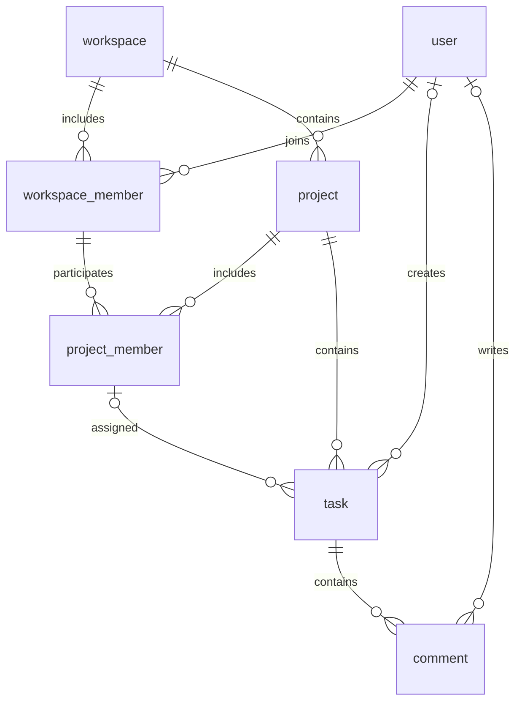

# Task Manager — Ứng dụng quản lý công việc

Bộ khung dùng chung cho team phát triển ứng dụng quản lý công việc bằng Python cơ bản và Flask. Ưu tiên cấu trúc dễ hiểu, tách trách nhiệm rõ ràng và không dùng ORM để thực hành SQL/SQLite.

## 1. Phạm vi hiện tại

- Application factory `create_app()` và Blueprint riêng cho từng module.
- Trang chủ, trang công việc mẫu, layout Bootstrap/Jinja2 dùng chung, trang lỗi 404/500.
- Kết nối SQLite theo application context, tự đóng kết nối và bật khóa ngoại.
- Schema 7 bảng: `user`, `workspace`, `workspace_member`, `project`, `project_member`, `task`, `comment`; lệnh `init-db` không xóa dữ liệu hiện có.
- Cấu hình Session, biến môi trường và bộ kiểm thử pytest.

**Chưa triển khai:** đăng ký/đăng nhập, phân quyền, CRUD, tìm kiếm/lọc công việc. Trang công việc chỉ là placeholder, không đọc dữ liệu thật. Các package `models` và `services` là vị trí để team bổ sung code, chưa có nghiệp vụ.

## 2. Tech stack

| Thành phần | Công nghệ | Vai trò |
| --- | --- | --- |
| Ngôn ngữ | Python 3.11+ | Xử lý nghiệp vụ; môi trường khởi tạo dùng Python 3.11 |
| Web framework | Flask 3.1 | Routing, request/response, Blueprint, Session |
| Giao diện | HTML5, Bootstrap 5.3.3 | Layout responsive; Bootstrap CSS qua CDN có SRI |
| Template | Jinja2 | Kế thừa layout, render dữ liệu; đi kèm Flask |
| Cơ sở dữ liệu | SQLite, module `sqlite3` | Lưu dữ liệu cục bộ; có sẵn trong Python |
| Session | Flask signed-cookie session | Lưu trạng thái nhỏ trong cookie có chữ ký |
| Cấu hình | python-dotenv | Nạp cấu hình từ `.env` |
| Kiểm thử | pytest | Kiểm tra route, database, session và cấu hình |

Không cần cài SQLite server, SQLAlchemy, Flask-Session hay Node.js. Flask tự cài các dependency như Jinja2, Werkzeug và Click. Trang vẫn trả HTML khi mất mạng, nhưng cần Internet để tải Bootstrap từ CDN. Chưa dùng các component cần Bootstrap JavaScript.

## 3. Cấu trúc thư mục

```text
task-manager/
├── app/
│   ├── __init__.py          # Application factory, đăng ký Blueprint và trang lỗi
│   ├── config.py            # Cấu hình chung và đọc biến môi trường
│   ├── db.py                # Kết nối SQLite, teardown, lệnh init-db
│   ├── schema.sql           # Bảng và index ban đầu
│   ├── main/
│   │   ├── __init__.py
│   │   └── routes.py        # Trang chủ
│   ├── tasks/
│   │   ├── __init__.py
│   │   └── routes.py        # Trang mẫu module công việc
│   ├── models/
│   │   └── __init__.py      # Nơi bổ sung truy vấn SQL (không phải ORM)
│   ├── services/
│   │   └── __init__.py      # Nơi bổ sung logic nghiệp vụ
│   ├── templates/
│   │   ├── base.html
│   │   ├── main/index.html
│   │   ├── tasks/index.html
│   │   └── errors/          # 404.html, 500.html
│   └── static/css/style.css
├── tests/
│   ├── conftest.py          # Fixture app/client, database tạm riêng từng test
│   ├── test_app.py
│   └── test_db.py
├── instance/               # Tự tạo; database local, không commit
├── .venv/                  # Môi trường Python local, không commit
├── .env                    # Cấu hình riêng từng máy, không commit
├── .env.example            # Mẫu cấu hình chung, được commit
├── .gitignore
├── pyproject.toml          # Cấu hình pytest
├── requirements.txt        # Dependency chạy ứng dụng
├── requirements-dev.txt    # Dependency phát triển/kiểm thử
└── README.md
```

## 4. Cài đặt và chạy trên Windows (PowerShell)

Chạy từ thư mục gốc repository, sau khi cài Python 3.11 trở lên:

```powershell
python -m venv .venv
.\.venv\Scripts\python.exe -m pip install -r requirements-dev.txt
Copy-Item .env.example .env
.\.venv\Scripts\python.exe -c "import secrets; print(secrets.token_hex(32))"
```

Chỉ copy `.env.example` khi chưa có `.env`, tránh ghi đè cấu hình riêng. Dán chuỗi ngẫu nhiên vừa sinh vào `SECRET_KEY` trong `.env`, không chia sẻ hoặc commit khóa này. Ứng dụng chủ động báo lỗi nếu thiếu khóa; không có khóa mặc định dùng chung.

```dotenv
SECRET_KEY=<chuỗi-ngẫu-nhiên-riêng-của-máy>
SESSION_COOKIE_SECURE=false
```

Khởi tạo database và chạy development server:

```powershell
.\.venv\Scripts\python.exe -m flask --app app init-db
.\.venv\Scripts\python.exe -m flask --app app run --debug
```

Truy cập <http://127.0.0.1:5000>. Dừng server bằng `Ctrl+C`.

Các lệnh dùng trực tiếp Python trong `.venv`, không cần activate hay thay đổi PowerShell execution policy. Trong VS Code, chọn **Python: Select Interpreter** → `.venv\Scripts\python.exe`; chọn **Python: Configure Tests** → **pytest** → **tests** để chạy bằng Test Explorer.

### Cấu hình môi trường

| Biến | Mặc định | Ý nghĩa |
| --- | --- | --- |
| `SECRET_KEY` | Không có, bắt buộc | Ký session cookie; giữ ổn định giữa các lần chạy/worker |
| `SESSION_COOKIE_SECURE` | `false` | Đặt `true` khi chạy HTTPS; local HTTP để `false` |

Biến môi trường hệ thống được ưu tiên hơn `.env`. Database mặc định nằm tại `instance/task_manager.sqlite3`; test ghi đè khóa cấu hình `DATABASE` để dùng file tạm. Không commit `.env`, `.venv`, database hoặc dữ liệu người dùng.

`--debug` và development server chỉ dành cho local. Khi triển khai thật, dùng WSGI server phù hợp (ví dụ Waitress trên Windows), HTTPS, khóa bí mật riêng và tắt debug; cấu hình triển khai production chưa thuộc bộ khung này.

## 5. Database và Session

### SQLite

Schema nằm trong [app/schema.sql](app/schema.sql), sử dụng tên bảng **số ít**.

| Bảng | Cột chính / chức năng |
| --- | --- |
| `user` | `id`, `username` duy nhất, `password_hash`, `created_at` |
| `workspace` | `id`, `name`, `description`, `created_at`, `updated_at` |
| `workspace_member` | Khóa chính ghép (`workspace_id`, `user_id`), `role`, `joined_at` |
| `project` | `id`, `workspace_id`, `name`, `description`, `created_at`, `updated_at` |
| `project_member` | Khóa chính ghép (`project_id`, `user_id`), `workspace_id`, `role`, `joined_at` |
| `task` | `id`, `project_id`, `created_by`, `assignee_id`, `title`, `description`, `status`, `due_date`, `created_at`, `updated_at` |
| `comment` | `id`, `task_id`, `author_id`, `content`, `created_at`, `updated_at` |



- Một workspace có nhiều project; một project có nhiều task; một task có nhiều comment.
- Member có role `owner`, `admin`, `member` ở từng cấp, mặc định `member`. Role workspace và project độc lập; schema chưa định nghĩa kế thừa quyền.
- Khóa ngoại ghép bảo đảm project member phải thuộc **đúng workspace của project**, kể cả khi cập nhật; không cho phép membership trùng.
- Task có thể chưa được giao (`assignee_id = NULL`) hoặc được giao cho đúng một project member. Chuyển project khi còn người được giao không thuộc project mới sẽ bị từ chối.
- `created_by` và `author_id` tham chiếu user và có thể NULL để giữ lịch sử khi user bị xóa. Khi tạo mới, service phải lấy tác giả từ session và kiểm tra quyền trong project, không tin ID gửi từ client.
- Trạng thái công việc: `todo`, `in_progress`, `done`; tên workspace/project, username, tiêu đề và nội dung comment không được rỗng hoặc chỉ gồm dấu cách.
- Xóa workspace → project/member → task → comment theo `ON DELETE CASCADE`; xóa project hoặc task cũng xóa dữ liệu con tương ứng.
- Không xóa member/user đang được giao task: phải bỏ giao hoặc giao lại các task trước trong cùng transaction. Xóa membership không xóa nội dung task/comment. Sau khi bỏ giao, xóa user sẽ xóa membership, đặt `created_by`/`author_id` về NULL và giữ nội dung.
- Quy tắc bắt buộc có owner, chuyển quyền owner, quyền đọc/ghi/xóa theo role và quyền bình luận phải được service triển khai; schema chỉ kiểm tra giá trị role, không giới hạn số owner.
- Index hỗ trợ tra cứu membership theo user, project theo workspace, task theo project/trạng thái/người được giao và comment theo task/thời gian.
- Quy ước `due_date` là `YYYY-MM-DD`; schema chưa kiểm tra định dạng nên service phải validate. Timestamp mặc định dùng UTC; khi sửa task, code cập nhật phải gán `updated_at = CURRENT_TIMESTAMP`.
- Dùng `get_db()` trong application/request context. Câu lệnh ghi phải `commit()`; khi lỗi cần `rollback()` hoặc dùng transaction context của connection.
- Luôn dùng SQL parameter `?`, không nối chuỗi/f-string với dữ liệu người dùng.
- `init-db` chỉ tạo bảng/index còn thiếu, **không phải migration**. Schema mới thay thế mô hình `users/tasks`; không chạy chồng lên database cũ vì sẽ để lại bảng cũ và không chuyển dữ liệu. Với database phát triển cũ, dừng server, sao lưu rồi chuyển file cũ ra khỏi đường dẫn `instance/task_manager.sqlite3` trước khi chạy `init-db` để tạo database rỗng. Nếu cần giữ dữ liệu trong mô hình mới, phải viết migration riêng. Không thêm lệnh xóa dữ liệu vào quá trình khởi động.

### Session

Dùng `session` tích hợp sẵn của Flask, không cần extension. Cookie được **ký, không mã hóa**: người dùng vẫn có thể đọc nội dung. Chỉ lưu dữ liệu nhỏ như `user_id`, không lưu mật khẩu, token bí mật hay toàn bộ danh sách task.

Khi bổ sung đăng nhập: xác thực bằng hash từ Werkzeug, gọi `session.clear()` trước khi gán `session["user_id"]`, đặt `session.permanent = True` nếu muốn áp dụng thời gian sống 8 giờ. Đăng xuất gọi `session.clear()`. Cấu hình cookie hiện có `HttpOnly`, `SameSite=Lax`; HTTPS phải bật `Secure`. Bộ khung chỉ cấu hình và kiểm thử session, chưa có route đăng nhập.

Trước khi thêm form/request thay đổi dữ liệu, bổ sung CSRF protection (ví dụ Flask-WTF), validation và kiểm tra chủ sở hữu ở server. `SameSite` không thay thế CSRF protection; không cho phép thay đổi dữ liệu bằng GET. Mọi truy vấn task sau khi có đăng nhập phải giới hạn theo project mà người dùng được phép truy cập; quyền sửa/xóa phải kiểm tra role tương ứng, không chỉ kiểm tra `assignee_id`.

## 6. Convention chính cho team

### Tổ chức code

- Luồng xử lý: **route → service → model/query → SQLite**. Route xử lý HTTP, service xử lý nghiệp vụ, model chứa truy vấn; tránh nhồi SQL hoặc logic vào template.
- Mỗi tính năng có Blueprint riêng; thêm module mới rồi đăng ký tại `create_app()`.
- Ví dụ tính năng tiếp theo: `app/auth/routes.py`, `app/services/auth_service.py`, `app/models/user.py`, `app/templates/auth/` và test tương ứng.
- Import không được tự chạy server hoặc khởi tạo/xóa database. Dùng `current_app`, `g`, `get_db()` thay vì tạo global connection.
- Code Python theo PEP 8, thụt lề 4 dấu cách; module/hàm/biến dùng `snake_case`, class `PascalCase`, hằng số `UPPER_SNAKE_CASE`.
- Tên code tiếng Anh, nội dung giao diện và tài liệu tiếng Việt; file UTF-8. Chỉ comment khi logic cần giải thích.
- Tên bảng số ít (`user`, `workspace`, `project`, `task`, `comment`), bảng liên kết `workspace_member`/`project_member`; cột `snake_case`, ID số nguyên. Khóa ngoại thường dạng `<entity>_id`; các cột theo vai trò gồm `created_by`, `assignee_id`, `author_id`.

### Giao diện và URL

- Template kế thừa `base.html`; đặt template theo module để tránh trùng tên.
- Các block chung: `title`, `content`, `extra_css`, `extra_js`.
- Dùng `url_for()` cho URL và static asset; không hard-code đường dẫn nội bộ.
- Giữ autoescape của Jinja2, không dùng `|safe` với dữ liệu người dùng.
- Flash message dùng các category `success`, `danger`, `warning`, `info`.
- GET chỉ đọc; POST dùng cho thao tác ghi của form và redirect sau khi thành công (Post/Redirect/Get).
- CSS riêng nằm trong `static/css/`; ưu tiên Bootstrap, tránh lặp inline CSS.

### Git và dependency

- Nhánh ngắn theo việc: `feature/<ten-chuc-nang>`, `fix/<ten-loi>`, `docs/<noi-dung>`.
- Commit theo nhóm: `feat:`, `fix:`, `docs:`, `test:`, `refactor:`, `chore:`.
- Pull request nêu mục đích, cách kiểm thử, ảnh giao diện nếu có; ít nhất một thành viên khác review trước khi merge.
- Thêm thư viện phải cập nhật đúng file requirements và README; không cài global. Các phiên bản đang dùng khoảng tương thích, chưa có lockfile nên không đảm bảo mọi máy resolve cùng patch version.
- Không commit file IDE cá nhân, secret, dữ liệu thật hoặc môi trường ảo. Không tự ý sửa module do thành viên khác phụ trách ngoài phạm vi task.

## 7. Kiểm thử

```powershell
.\.venv\Scripts\python.exe -m pytest -q
```

Chạy riêng phần đang sửa, ví dụ:

```powershell
.\.venv\Scripts\python.exe -m pytest tests\test_db.py -q
```

Test dùng database trong thư mục tạm, không tác động database local. Hiện bao phủ các trang mẫu, static CSS, trang lỗi, thiếu secret, cấu hình cookie, session/flash, autoescape, lifecycle connection, schema constraint và việc chạy lại `init-db` giữ dữ liệu. Mọi tính năng mới cần bổ sung test cho luồng thành công và đầu vào/quyền truy cập không hợp lệ.

## 8. Gợi ý phân công tiếp theo

| Mảng | Trách nhiệm |
| --- | --- |
| Nền tảng/database | Config, schema/migration, helper, test infrastructure |
| Tài khoản | Đăng ký, đăng nhập/đăng xuất, password hash, session, phân quyền |
| Công việc | CRUD, trạng thái, hạn hoàn thành, lọc theo người dùng |
| Giao diện/QA | Template dùng chung, responsive, thông báo lỗi, kiểm thử |

Thống nhất schema, endpoint và dữ liệu đầu vào/đầu ra trước khi phát triển song song. Hoàn thiện đăng nhập, quyền sở hữu và CSRF trước khi công khai chức năng thay đổi dữ liệu.