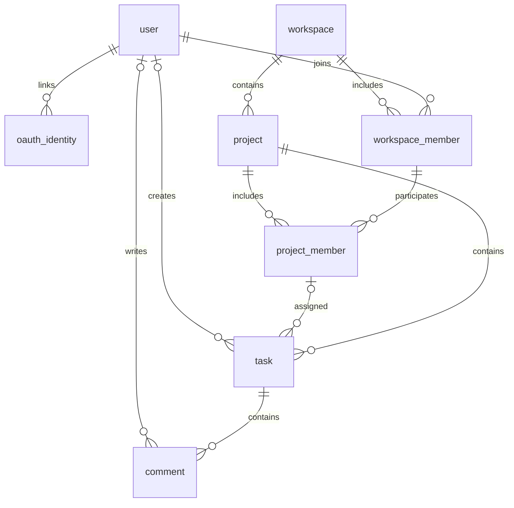

# Kairo — Ứng dụng quản lý công việc

Bộ khung dùng chung cho team phát triển ứng dụng quản lý công việc bằng Python cơ bản và Flask. Ưu tiên cấu trúc dễ hiểu, tách trách nhiệm rõ ràng và không dùng ORM để thực hành SQL/SQLite.

## 1. Phạm vi hiện tại

- Application factory `create_app()` và Blueprint riêng cho từng module.
- Trang chủ chuyển người chưa đăng nhập đến trang đăng nhập; giao diện đăng nhập, đăng ký, cài đặt tài khoản và bảng Kanban dùng Jinja2/CSS tùy chỉnh.
- API đăng nhập, phân quyền workspace/project, CRUD task và thông báo trong ứng dụng; các API được kiểm thử bằng pytest.
- Kết nối SQLite theo application context, tự đóng kết nối và bật khóa ngoại.
- Schema gồm các bảng `user`, `oauth_identity`, `workspace`, `workspace_member`, `project`, `project_member`, `member_invitation`, `password_reset_token`, `password_reset_attempt`, `sprint`, `sprint_task_history`, `task`, `comment`, `notification` và bảng `schema_migration`; lệnh `init-db` áp dụng migration và tạo index, không xóa dữ liệu hiện có.
- Cấu hình Session, biến môi trường và bộ kiểm thử pytest.

**Trạng thái UI:** `/login`, `/register` và `/settings` kết nối với API tài khoản; “Quên mật khẩu?” mở `/password-reset`. Đặt lại mật khẩu gửi phản hồi chung để tránh dò email; token ngẫu nhiên một lần chỉ lưu dưới dạng SHA-256, hết hạn sau 30 phút và email dùng chung cấu hình SMTP lời mời. Yêu cầu được giới hạn một lần/email/15 phút và 10 lần/IP/giờ. Google-only account không nhận luồng đặt lại mật khẩu local. Kanban tải dữ liệu thật khi đã đăng nhập và có project; tạo/sửa/xóa task, kéo thả, bộ lọc và danh sách được nối với API. Bấm vào task để xem chi tiết và đọc/thêm/sửa/xóa bình luận theo quyền. Vị trí task trong từng cột được lưu sau kéo thả hoặc sắp xếp. Có thể đổi theme tối/sáng; mỗi cột hiện ô thêm task khi chưa có card, còn nút `+` trên tiêu đề luôn mở form. Task có thể thuộc tối đa một Sprint hoặc ở backlog. Trang `/sprints/` hỗ trợ lập kế hoạch, chỉnh sửa, bắt đầu và hoàn tất Sprint; `/sprints/progress` hiển thị số liệu trạng thái, task quá hạn và burndown dựa trên lịch sử task. Mỗi project chỉ có tối đa một Sprint đang chạy; chỉ Project Admin/Workspace Owner quản lý Sprint. Trang `/workspaces/<id>/members/page` và `/workspaces/<id>/projects/<id>/members/page` liệt kê thành viên; admin có thể mời qua email, xem lời mời chờ, gửi lại hoặc thu hồi. Trang thành viên cũng có thao tác tạo/sửa/xóa workspace, sửa/xóa project, chuyển quyền Owner và rời workspace theo role. Lời mời chỉ cấp Member, hết hạn sau 7 ngày và chỉ được chấp nhận bởi tài khoản có email khớp. Khi SMTP chưa cấu hình, giao diện cung cấp liên kết mời để sao chép. Trang `/tasks/my` tổng hợp task của người dùng theo project hoặc hạn hoàn thành. Chuông thông báo hiển thị sự kiện được giao/giao lại task, đổi trạng thái, bình luận và `@username`; mục được polling mỗi phút, có thể đánh dấu đã đọc hoặc xóa thông báo đã đọc. Người chưa đăng nhập hoặc chưa có project sẽ thấy bản demo Kanban. Google OAuth yêu cầu client ID/secret và callback URL trong `.env`; email Google phải được xác minh, tài khoản local trùng email cần được liên kết tường minh. Task API hỗ trợ `todo`, `in_progress`, `review`, `done` cùng priority `low`, `medium`, `high`.

## 2. Tech stack

| Thành phần    | Công nghệ                   | Vai trò                                               |
| ------------- | --------------------------- | ----------------------------------------------------- | --- |
| Ngôn ngữ      | Python 3.11+                | Xử lý nghiệp vụ; môi trường khởi tạo dùng Python 3.11 |
| Web framework | Flask 3.1                   | Routing, request/response, Blueprint, Session         |
| Giao diện     | HTML5, Bootstrap 5, Bootstrap Icons, CSS tùy chỉnh, SortableJS | Auth/settings và Kanban responsive; tài nguyên frontend tải qua CDN |
| Template      | Jinja2                      | Kế thừa layout, render dữ liệu; đi kèm Flask          |
| Cơ sở dữ liệu | SQLite, module `sqlite3`    | Lưu dữ liệu cục bộ; có sẵn trong Python               |
| Session       | Flask signed-cookie session | Lưu trạng thái nhỏ trong cookie có chữ ký             |
| OAuth         | Authlib, Google OIDC         | Đăng nhập Google tùy chọn; credentials từ `.env`      |
| Cấu hình      | python-dotenv               | Nạp cấu hình từ `.env`                                |
| Kiểm thử      | pytest                      | Kiểm tra route, database, session và cấu hình         |

Không cần cài SQLite server, SQLAlchemy, Flask-Session hay Node.js. Flask tự cài các dependency như Jinja2, Werkzeug và Click. Các trang vẫn trả HTML khi mất mạng; cần Internet để tải Bootstrap CSS, Bootstrap Icons, SortableJS và font từ CDN. Chưa dùng component cần Bootstrap JavaScript.

## 3. Cấu trúc thư mục

```text
task-manager/
├── app/
│   ├── __init__.py          # Application factory, đăng ký Blueprint và trang lỗi
│   ├── config.py            # Cấu hình chung và đọc biến môi trường
│   ├── db.py                # Kết nối SQLite, teardown, lệnh init-db
│   ├── schema.sql           # Định nghĩa bảng
│   ├── migrations.py        # Migration schema có version
│   ├── indexes.sql          # Index tạo sau khi áp dụng migration
│   ├── auth/
│   │   └── routes.py        # Session, đăng nhập, hồ sơ và avatar API
│   ├── main/
│   │   ├── __init__.py
│   │   └── routes.py        # Trang chủ, đăng nhập, đăng ký, cài đặt
│   ├── tasks/
│   │   ├── __init__.py     # Trang Kanban demo và API task
│   │   └── routes.py        # Task API
│   ├── notifications.py    # API thông báo cá nhân
│   ├── models/
│   │   ├── notification.py # Truy vấn notification
│   │   ├── sprint.py       # Truy vấn Sprint và lịch sử task
│   │   ├── task.py         # Truy vấn task
│   │   └── user.py         # Truy vấn user
│   ├── services/
│   │   ├── auth_service.py # Nghiệp vụ auth và user profile
│   │   ├── notification_service.py # Tạo và quản lý notification
│   │   ├── sprint_service.py # Nghiệp vụ Sprint và tiến độ
│   │   └── task_service.py # Nghiệp vụ task
│   ├── templates/
│   │   ├── base.html
│   │   ├── login.html, register.html, settings.html
│   │   ├── main/index.html
│   │   ├── tasks/index.html
│   │   ├── sprints/         # Sprint planning and progress pages
│   │   └── errors/          # 404.html, 500.html
│   └── static/
│       ├── css/             # Auth, settings, Kanban, and Sprint styles
│       └── js/              # Auth, settings, Kanban, and Sprint scripts
├── tests/
│   ├── conftest.py          # Fixture app/client, database tạm riêng từng test
│   ├── test_app.py
│   └── test_db.py
├── instance/               # Tự tạo; database local, không commit
├── .venv/                  # Môi trường Python local, không commit
├── .env                    # Cấu hình riêng từng máy, không commit
├── .env.example            # Mẫu cấu hình chung, được commit
├── .gitignore
├── pyproject.toml          # Cấu hình pytest
├── requirements.txt        # Dependency chạy ứng dụng
├── requirements-dev.txt    # Dependency phát triển/kiểm thử
└── README.md
```

## 4. Cài đặt và chạy trên Windows (PowerShell)

Chạy từ thư mục gốc repository, sau khi cài Python 3.11 trở lên:

```powershell
python -m venv .venv
.\.venv\Scripts\python.exe -m pip install -r requirements-dev.txt
Copy-Item .env.example .env
.\.venv\Scripts\python.exe -c "import secrets; print(secrets.token_hex(32))"
```

Chỉ copy `.env.example` khi chưa có `.env`, tránh ghi đè cấu hình riêng. Dán chuỗi ngẫu nhiên vừa sinh vào `SECRET_KEY` trong `.env`, không chia sẻ hoặc commit khóa này. Ứng dụng chủ động báo lỗi nếu thiếu khóa; không có khóa mặc định dùng chung.

```dotenv
SECRET_KEY=<chuỗi-ngẫu-nhiên-riêng-của-máy>
SESSION_COOKIE_SECURE=false
```

Khởi tạo database và chạy development server:

```powershell
.\.venv\Scripts\python.exe -m flask --app app init-db
.\.venv\Scripts\python.exe -m flask --app app run --debug
```

Truy cập <http://127.0.0.1:5000>. Dừng server bằng `Ctrl+C`.

Các lệnh dùng trực tiếp Python trong `.venv`, không cần activate hay thay đổi PowerShell execution policy. Trong VS Code, chọn **Python: Select Interpreter** → `.venv\Scripts\python.exe`; chọn **Python: Configure Tests** → **pytest** → **tests** để chạy bằng Test Explorer.

### Cấu hình môi trường

| Biến                    | Mặc định           | Ý nghĩa                                                 |
| ----------------------- | ------------------ | ------------------------------------------------------- |
| `SECRET_KEY`            | Không có, bắt buộc | Ký session cookie; giữ ổn định giữa các lần chạy/worker |
| `SESSION_COOKIE_SECURE` | `false`            | Đặt `true` khi chạy HTTPS; local HTTP để `false`        |
| `GOOGLE_CLIENT_ID` / `GOOGLE_CLIENT_SECRET` | Không có | Cấu hình Google OAuth; giữ secret trong `.env`, không commit |
| `GOOGLE_REDIRECT_URI` | `http://127.0.0.1:5000/auth/google/callback` | Callback phải khớp cấu hình trong Google Cloud Console |
| `PUBLIC_APP_URL` | Không có | URL gốc công khai của ứng dụng, bắt buộc để tạo liên kết email tuyệt đối |
| `SMTP_HOST` / `SMTP_PORT` | Không có / `587` | Máy chủ và cổng SMTP; phải cấu hình cùng `SMTP_FROM` để gửi email |
| `SMTP_FROM` | Không có | Địa chỉ/tên người gửi email lời mời và đặt lại mật khẩu |
| `SMTP_USERNAME` / `SMTP_PASSWORD` | Không có | Xác thực SMTP tùy chọn; phải cấu hình cả hai hoặc để trống cả hai |
| `SMTP_USE_TLS` / `SMTP_USE_SSL` | `true` / `false` | Dùng STARTTLS hoặc TLS trực tiếp; không bật đồng thời |

SMTP chưa cấu hình hoặc lỗi gửi không làm mất lời mời: giao diện hiển thị liên kết một lần để sao chép. Token lời mời chỉ lưu SHA-256; gửi lại tạo token mới, thu hồi token cũ. Lời mời hết hạn sau 7 ngày. Đặt lại mật khẩu dùng cùng `PUBLIC_APP_URL` và SMTP; khi gửi thất bại token reset bị xóa, còn phản hồi API vẫn chung. Link reset đặt token trong fragment để trình duyệt không gửi token trong request URL/access log. Không commit `.env`, mật khẩu SMTP hoặc dữ liệu người dùng.

Biến môi trường hệ thống được ưu tiên hơn `.env`. Database mặc định nằm tại `instance/task_manager.sqlite3`; test ghi đè khóa cấu hình `DATABASE` để dùng file tạm.

`--debug` và development server chỉ dành cho local. Khi triển khai thật, dùng WSGI server phù hợp (ví dụ Waitress trên Windows), HTTPS, khóa bí mật riêng và tắt debug; cấu hình triển khai production chưa thuộc bộ khung này.

## 5. Database và Session

### SQLite

Schema nằm trong [app/schema.sql](app/schema.sql), sử dụng tên bảng **số ít**.

| Bảng               | Cột chính / chức năng                                                                                                                   |
| ------------------ | --------------------------------------------------------------------------------------------------------------------------------------- |
| `user`             | `id`, `username` duy nhất, `display_name`, `email` duy nhất (nullable cho tài khoản cũ), `avatar_path`, `auth_version`, `password_login_enabled`, `password_hash`, timestamps |
| `oauth_identity`   | Provider Google và `subject` duy nhất; liên kết identity với user sau OAuth đã xác minh |
| `workspace`        | `id`, `name`, `description`, `created_by`, `updated_by`, `created_at`, `updated_at`                                                     |
| `workspace_member` | Khóa chính ghép (`workspace_id`, `user_id`), `role`, `joined_at`                                                                        |
| `project`          | `id`, `workspace_id`, `name`, `description`, `created_by`, `updated_by`, `created_at`, `updated_at`                                     |
| `project_member`   | Khóa chính ghép (`project_id`, `user_id`), `workspace_id`, `role`, `joined_at`                                                          |
| `member_invitation` | Email, phạm vi workspace/project, role Member, hash token, hạn dùng và trạng thái chấp nhận/thu hồi |
| `password_reset_token` | User, hash token reset, thời hạn 30 phút và trạng thái đã dùng |
| `password_reset_attempt` | HMAC email/IP và thời điểm để giới hạn yêu cầu reset |
| `task`             | `id`, `project_id`, `created_by`, `assignee_id`, `updated_by`, `title`, `description`, `status`, `priority`, `due_date`, timestamps     |
| `comment`          | `id`, `task_id`, `author_id`, `updated_by`, `content`, `created_at`, `updated_at`                                                       |
| `notification`     | Người nhận, actor, loại sự kiện, metadata, đường dẫn nội bộ, `read_at` và thời điểm tạo                                                   |



- Một workspace có nhiều project; một project có nhiều task; một task có nhiều comment.
- Member có role `owner`, `admin`, `member` ở từng cấp, mặc định `member`. Role workspace và project độc lập; schema chưa định nghĩa kế thừa quyền.
- Khóa ngoại ghép bảo đảm project member phải thuộc **đúng workspace của project**, kể cả khi cập nhật; không cho phép membership trùng.
- Task có thể chưa được giao (`assignee_id = NULL`) hoặc được giao cho đúng một project member. Chuyển project khi còn người được giao không thuộc project mới sẽ bị từ chối.
- Các trường audit (`created_by`, `updated_by`, `author_id`) tham chiếu user và có thể NULL để giữ lịch sử khi user bị xóa. Khi tạo/sửa, service phải lấy người thao tác từ session và kiểm tra quyền, không tin ID gửi từ client.
- Trạng thái công việc: `todo`, `in_progress`, `review`, `done`; priority: `low`, `medium`, `high` (mặc định `medium`). Username, tên hiển thị, email đăng ký, tiêu đề và nội dung comment được validate ở API.
- Xóa workspace → project/member → task → comment theo `ON DELETE CASCADE`; xóa project hoặc task cũng xóa dữ liệu con tương ứng.
- Không xóa member/user đang được giao task: phải bỏ giao hoặc giao lại các task trước trong cùng transaction. Xóa membership không xóa nội dung task/comment. Sau khi bỏ giao, xóa user sẽ xóa membership, đặt `created_by`/`author_id` về NULL và giữ nội dung.
- Quy tắc bắt buộc có owner, chuyển quyền owner, quyền đọc/ghi/xóa theo role và quyền bình luận phải được service triển khai; schema chỉ kiểm tra giá trị role, không giới hạn số owner.
- Index hỗ trợ tra cứu membership theo user, project theo workspace, task theo project/trạng thái/thứ tự/người được giao và comment theo task/thời gian.
- Quy ước `due_date` là `YYYY-MM-DD`; schema chưa kiểm tra định dạng nên service phải validate. Timestamp mặc định dùng UTC; khi sửa task, code cập nhật phải gán `updated_at = CURRENT_TIMESTAMP`.
- Dùng `get_db()` trong application/request context. Câu lệnh ghi phải `commit()`; khi lỗi cần `rollback()` hoặc dùng transaction context của connection.
- Luôn dùng SQL parameter `?`, không nối chuỗi/f-string với dữ liệu người dùng.
- `init-db` tạo bảng/index còn thiếu và áp dụng migration phiên bản, gồm Review/priority, hồ sơ user, OAuth identity, lời mời thành viên (v11), notification (v12) và password reset (v13) và vị trí task (v14). Lệnh này không chuyển dữ liệu từ mô hình cũ `users/tasks`; database dạng cũ vẫn cần migration riêng để chuyển dữ liệu. Không thêm lệnh xóa dữ liệu vào quá trình khởi động.

### Notification API

Các endpoint yêu cầu đăng nhập; thao tác thay đổi dữ liệu vẫn áp dụng CSRF. `GET /notifications?limit=20` trả danh sách gần đây (tối đa 50) và `unread_count`. Đánh dấu một thông báo: `POST /notifications/<id>/read`; đánh dấu tất cả đã đọc: `POST /notifications/read-all`; xóa thông báo đã đọc: `DELETE /notifications/read`. Mỗi truy vấn/thao tác chỉ áp dụng cho người nhận hiện tại; ID của người khác trả về 404.

Thông báo được tạo cùng transaction của task/comment cho sự kiện giao task, giao lại, đổi trạng thái, bình luận mới tới creator/assignee và `@username` tới project member được nhắc. Không gửi cho actor; mention và comment recipient được khử trùng lặp. `link_path` chỉ chứa đường dẫn task nội bộ tương đối. Migration v12 thêm bảng/index notification và giữ migration lời mời v11 nguyên trạng.

### Session

Dùng `session` tích hợp sẵn của Flask, không cần extension. Cookie được **ký, không mã hóa**: người dùng vẫn có thể đọc nội dung. Chỉ lưu dữ liệu nhỏ như `user_id`, không lưu mật khẩu, token bí mật hay toàn bộ danh sách task.

Đăng nhập username và Google OIDC dùng session ký bởi Flask; cookie hiện có `HttpOnly`, `SameSite=Lax`, và HTTPS cần bật `Secure`. Sau khi đổi mật khẩu, `auth_version` trong database vô hiệu hóa các phiên cũ. Google OAuth yêu cầu client ID/secret và callback URL trong `.env`; email Google phải được xác minh, email khớp tài khoản hiện có chỉ được liên kết sau khi user đăng nhập.

Trước khi thêm form/request thay đổi dữ liệu, bổ sung CSRF protection (ví dụ Flask-WTF), validation và kiểm tra chủ sở hữu ở server. `SameSite` không thay thế CSRF protection; không cho phép thay đổi dữ liệu bằng GET. Mọi truy vấn task sau khi có đăng nhập phải giới hạn theo project mà người dùng được phép truy cập; quyền sửa/xóa phải kiểm tra role tương ứng, không chỉ kiểm tra `assignee_id`.

## 6. Convention chính cho team

### Tổ chức code

- Luồng xử lý: **route → service → model/query → SQLite**. Route xử lý HTTP, service xử lý nghiệp vụ, model chứa truy vấn; tránh nhồi SQL hoặc logic vào template.
- Mỗi tính năng có Blueprint riêng; thêm module mới rồi đăng ký tại `create_app()`.
- Ví dụ tính năng tiếp theo: `app/auth/routes.py`, `app/services/auth_service.py`, `app/models/user.py`, `app/templates/auth/` và test tương ứng.
- Import không được tự chạy server hoặc khởi tạo/xóa database. Dùng `current_app`, `g`, `get_db()` thay vì tạo global connection.
- Code Python theo PEP 8, thụt lề 4 dấu cách; module/hàm/biến dùng `snake_case`, class `PascalCase`, hằng số `UPPER_SNAKE_CASE`.
- Tên code tiếng Anh, nội dung giao diện và tài liệu tiếng Việt; file UTF-8. Chỉ comment khi logic cần giải thích.
- Tên bảng số ít (`user`, `workspace`, `project`, `task`, `comment`), bảng liên kết `workspace_member`/`project_member`; cột `snake_case`, ID số nguyên. Khóa ngoại thường dạng `<entity>_id`; các cột theo vai trò gồm `created_by`, `assignee_id`, `author_id`.

### Giao diện và URL

- Template kế thừa `base.html`; đặt template theo module để tránh trùng tên.
- Các block chung: `title`, `content`, `extra_css`, `extra_js`.
- Dùng `url_for()` cho URL và static asset; không hard-code đường dẫn nội bộ.
- Giữ autoescape của Jinja2, không dùng `|safe` với dữ liệu người dùng.
- Flash message dùng các category `success`, `danger`, `warning`, `info`.
- GET chỉ đọc; POST dùng cho thao tác ghi của form và redirect sau khi thành công (Post/Redirect/Get).
- CSS riêng nằm trong `static/css/`; ưu tiên Bootstrap, tránh lặp inline CSS.

### Git và dependency

- Nhánh ngắn theo việc: `feature/<ten-chuc-nang>`, `fix/<ten-loi>`, `docs/<noi-dung>`.
- Commit theo nhóm: `feat:`, `fix:`, `docs:`, `test:`, `refactor:`, `chore:`.
- Pull request nêu mục đích, cách kiểm thử, ảnh giao diện nếu có; ít nhất một thành viên khác review trước khi merge.
- Thêm thư viện phải cập nhật đúng file requirements và README; không cài global. Các phiên bản đang dùng khoảng tương thích, chưa có lockfile nên không đảm bảo mọi máy resolve cùng patch version.
- Không commit file IDE cá nhân, secret, dữ liệu thật hoặc môi trường ảo. Không tự ý sửa module do thành viên khác phụ trách ngoài phạm vi task.

## 7. Kiểm thử

```powershell
.\.venv\Scripts\python.exe -m pytest -q
```

Chạy riêng phần đang sửa, ví dụ:

```powershell
.\.venv\Scripts\python.exe -m pytest tests\test_db.py -q
```

Test dùng database trong thư mục tạm, không tác động database local. Hiện bao phủ các trang mẫu, static CSS, trang lỗi, thiếu secret, cấu hình cookie, session/flash, autoescape, lifecycle connection, schema constraint và việc chạy lại `init-db` giữ dữ liệu. Mọi tính năng mới cần bổ sung test cho luồng thành công và đầu vào/quyền truy cập không hợp lệ.

## 8. Gợi ý phân công tiếp theo

| Mảng              | Trách nhiệm                                                      |
| ----------------- | ---------------------------------------------------------------- |
| Nền tảng/database | Config, schema/migration, helper, test infrastructure            |
| Tài khoản         | Đăng ký, đăng nhập/đăng xuất, password hash, session, phân quyền |
| Công việc         | CRUD, trạng thái, hạn hoàn thành, lọc theo người dùng            |
| Giao diện/QA      | Template dùng chung, responsive, thông báo lỗi, kiểm thử         |

Thống nhất schema, endpoint và dữ liệu đầu vào/đầu ra trước khi phát triển song song. Hoàn thiện đăng nhập, quyền sở hữu và CSRF trước khi công khai chức năng thay đổi dữ liệu.
